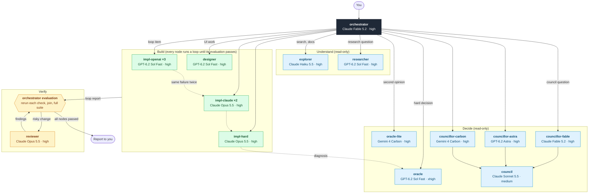

# Agent graph

- Every result returns to the orchestrator. Workers never talk to each other.
- Solid arrows are handoffs. Dashed arrows are escalation routes, which the orchestrator takes when a node fails the same way twice.
- Blue nodes are read-only, green nodes write files, amber nodes are gates.
- The pool sizes (×2, ×1, ×2) are the standing pool; the orchestrator can start more of any type.

